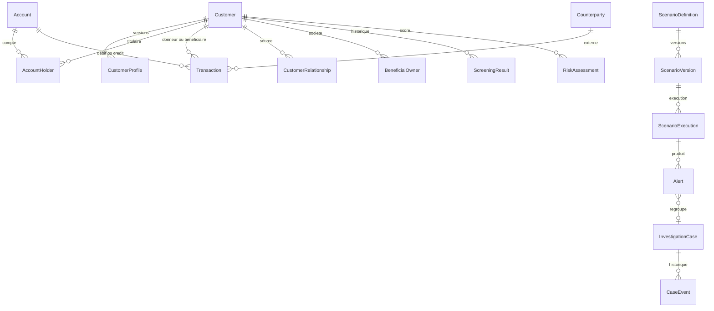
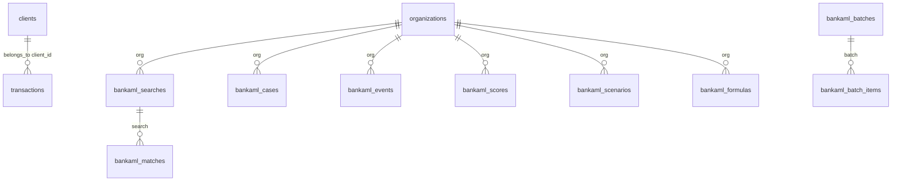

# Modèle de données AML

Ce document compare le modèle métier cible avec ce qui existe réellement dans Marble v1.12 et dans le module complémentaire `api/bankaml`. Aucun champ n’est décrit comme présent s’il n’a pas été lu dans le code ou dans la configuration GitOps `k8s-gitops/apps/aml/base/init-config.yaml`.

Les tables `clients` et `transactions` déjà créées dans Marble ne sont pas remplacées.

## Deux stockages distincts

Marble sépare les données client ingérées et les objets de la plateforme.

| Couche | Où | Rôle |
|---|---|---|
| Data model Marble | tables d’organisation créées par l’API data model | objets déclencheurs des scénarios natifs |
| Plateforme Marble | `organizations`, `cases`, `decisions`, screening natif | cas, décisions, screening sous licence |
| Module `bankaml` | tables `bankaml_*` dans le schéma `public` | screening, dossiers, score et scénarios UC hors licence |

Chaque objet ingéré par Marble reçoit les champs réservés `id`, `valid_from` et `valid_until` (`api/models/data_model.go`). Ce n’est pas un profil KYC versionné : c’est l’historique d’ingestion de Marble.

## Entités cibles et correspondances

| Entité cible | Existant | Décision |
|---|---|---|
| Customer | table Marble `clients` | réutilisée, champs incomplets |
| CustomerProfile | `ClientProfile` dans `bankaml`, non persisté comme table | complément partiel, non versionné en base |
| Account | champ `account_id` sur la transaction du module | pas de table |
| Transaction | table Marble `transactions` et struct `bankaml.Transaction` | deux formes, pas le même schéma |
| Counterparty | chaîne `counterparty` dans `bankaml.Transaction` | pas d’entité |
| CustomerRelationship | absent | à créer seulement si le métier le confirme |
| BeneficialOwner | absent | absent |
| ScreeningResult | `bankaml_matches` et le screening natif sous licence | le module complémentaire est celui qui tourne sans licence |
| RiskAssessment | `bankaml_scores` | score séparé du statut sanctions |
| ScenarioDefinition | scénario Marble et `bankaml_scenarios` | deux moteurs |
| ScenarioVersion | itération Marble et colonne `version` de `bankaml_scenarios` | les deux existent, avec des états différents |
| ScenarioExecution | décisions Marble ; pas d’équivalent `bankaml` | le module évalue une population fournie par l’appelant |
| Alert | décision Marble ; alerte embarquée dans `bankaml_cases.alert` | pas de table `bankaml_alerts` |
| InvestigationCase | `cases` Marble (`pending`, `investigating`, `closed`) et `bankaml_cases` | le dossier complémentaire porte le circuit à quatre yeux |
| CaseEvent | `bankaml_events` et les événements de cas Marble | les deux journaux existent |
| DataSourceRecord | absent | absent |
| AuditEvent | `bankaml_events` | journal du module, pas un audit transverse de Marble |

## Diagramme cible

Ce diagramme est le modèle cible. Il n’est pas le schéma déployé.

## Diagramme réellement déployé

La relation `transactions.client_id -> clients` est un lien Marble `belongs_to`. Elle a été créée par le job `marble-init-aml-8`. Les tables `bankaml_*` apparaissent après la migration `20261022193000_bank_aml.sql`, exécutée par l’image `latest`.

## Principes retenus

- Le nom n’est pas une clé. Marble identifie un objet par `object_id`. Le module utilise `client_ref`.
- Personne et société partagent la table `clients`. Le type n’est pas un champ de cette table. Le screening natif est configuré en `Person`.
- Les montants Marble sont des `Float`, pas des décimaux. Le module additionne des `float64` sans conversion de devise.
- Une similarité OpenSanctions n’est pas une identité confirmée. Le score client ne neutralise pas un signal sanctions : `sanctions_status` et `review_required` sont séparés du total.
- Les seuils présents dans le code et dans l’initialisation sont des exemples de la banque. Ce ne sont pas des seuils légaux.
