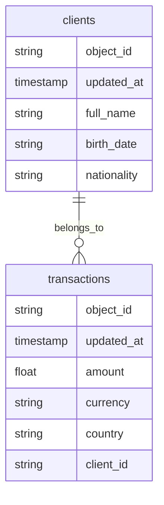
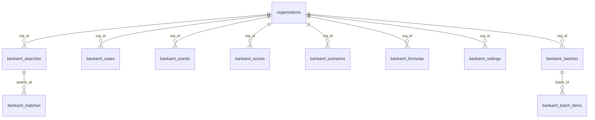

# Relations entre entités

## Relation déployée

Source : `k8s-gitops/apps/aml/base/init-config.yaml`. Le lien est `link_type: belongs_to`, champ enfant `client_id`, parent `clients`. Un compte, une contrepartie ou un second titulaire ne participent pas à ce graphe.

Marble peut exprimer d’autres liens de data model. Aucun autre lien n’est créé par l’initialisation actuelle.

## Relations du module `bankaml`

`bankaml_events.org_id` et `bankaml_batch_items.org_id` ne sont pas des clés étrangères dans la migration. Les autres `org_id` référencent `organizations(id)`.

`bankaml_cases` ne référence pas `bankaml_matches` ni `bankaml_scenarios` par clé étrangère. Le lien est `client_ref`, `scenario_code` et le JSON `alert` / `screening`.

## Relations cibles non créées

| Relation cible | État |
|---|---|
| Customer 1—n CustomerProfile versionné | le profil est un objet de requête |
| Account n—n Customer via AccountHolder | absent |
| Transaction vers deux comptes et deux contreparties | absent |
| CustomerRelationship | absent |
| BeneficialOwner | absent |
| ScreeningResult.previous_result_id | absent ; l’historique est une nouvelle ligne |
| Alert vers ScenarioVersion et ScenarioExecution | l’alerte est dans le dossier |
| InvestigationCase vers plusieurs alertes | un dossier a un `alert_key` |

## Rapprochement

Le module ne fusionne pas deux contreparties parce que leurs noms se ressemblent. Il ne fusionne pas non plus un client Marble et un `client_ref` du module : les deux identifiants doivent être alimentés ensemble par l’appelant. Cette stratégie est explicite parce qu’aucune autre n’est codée.

Les liens inférés et les liens confirmés par un document KYC ne sont pas distingués, parce que les tables de relation n’existent pas.
