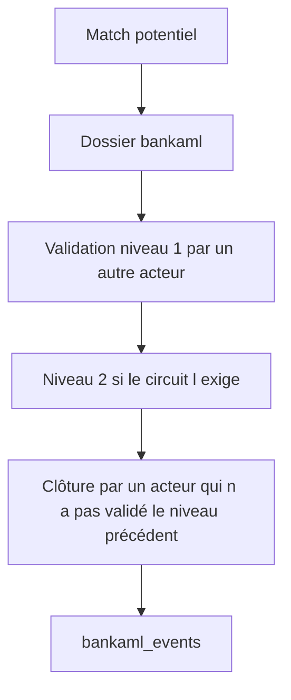

# Écarts entre le modèle cible et le modèle existant

L’image `latest` déployée est `docker.io/nexusbank/marble-backend:latest` et `docker.io/nexusbank/marble-frontend:latest`. Les tables Marble `clients` et `transactions` ne sont pas recréées. Les tables `bankaml_*` sont ajoutées par la migration, à côté du data model existant.

## Parcours de revue

Le cas Marble natif s’arrête à `pending`, `investigating` et `closed`. Le quatre yeux décrit ici est celui de `bankaml/workflow.go`.

## Priorité

| Priorité | Écart | Pourquoi | Intégration proposée |
|---|---|---|---|
| P0 | Les UC01–UC12 et le score ne lisent pas les tables Marble | la population est fournie par l’appelant | connecteur d’ingestion vers `ClientInput` et `Transaction`, sans remplacer `clients` |
| P0 | Customer, Account, Counterparty et le profil KYC versionné sont incomplets ou absents | le data model déployé a 6 et 6 champs | nouvelles tables Marble seulement après validation métier, en liens `belongs_to`, sans réécrire `clients` |
| P1 | AML-006, 009, 011, 014, 015, 017, 018, 021, 022, 024, 025 n’ont pas de code | le catalogue s’arrête aux UC et à deux règles natives | nouveaux UC ou règles Marble, désactivés, avec tests synthétiques |
| P1 | Pas de version de liste de pays, pas de solde, pas de devise de base | les sommes mélangent les devises | champ `amount_base_currency` et liste datée avant d’activer UC07 |
| P1 | Screening natif non publié | entitlement sanctions | garder le module ; ne pas retirer le contrôle de licence |
| P2 | Alerte, exécution et déduplication ne suivent pas le JSON cible | l’alerte est dans le dossier | étendre `bankaml_cases` quand le circuit réel est figé |
| P2 | `DataSourceRecord` et l’idempotence d’ingestion sont absents | pas de `source_system` | clé d’ingestion Marble ou table de provenance |
| P2 | Simulation sans rapport persisté | l’évaluation peut ne pas ouvrir de dossier, mais ne garde pas les compteurs | table d’exécution si la conformité exige l’historique de test |
| P3 | Cas Marble et dossier `bankaml` ne sont pas le même objet | deux circuits | choisir le dossier du module pour le quatre yeux, laisser le cas Marble à son flux natif |
| P3 | Sémantiques Marble utiles non posées sur `clients` | `date_of_birth`, `first_name`, `registration_number` existent comme sémantiques, pas comme champs déployés | les ajouter sur `clients` sans changer `object_id` |

## Décisions déjà prises

- Ne pas remplacer `clients` ni `transactions`.
- Ne pas créer les 17 entités cibles tant que le métier n’a pas validé les champs obligatoires.
- Ne pas activer les UC : ils restent en brouillon.
- Ne pas traiter un score faible comme une clôture de sanctions.
- Ne pas écrire la clé OpenSanctions dans Git.

## Non vérifié dans cet audit

- Le contenu réel des lignes `clients` et `transactions` dans la base du sandbox au moment de la rédaction. Le schéma déployé est celui du job d’initialisation, pas un export de production.
- Le catalogue de datasets renvoyé aujourd’hui par `api.opensanctions.org` pour le scope `default`.
- Le fait que le nœud du sandbox puisse tirer l’image `nexusbank` tant que le rollout n’est pas terminé.
- La liste complète des fonctions AST Marble au-delà de celles utilisées par l’initialisation.
