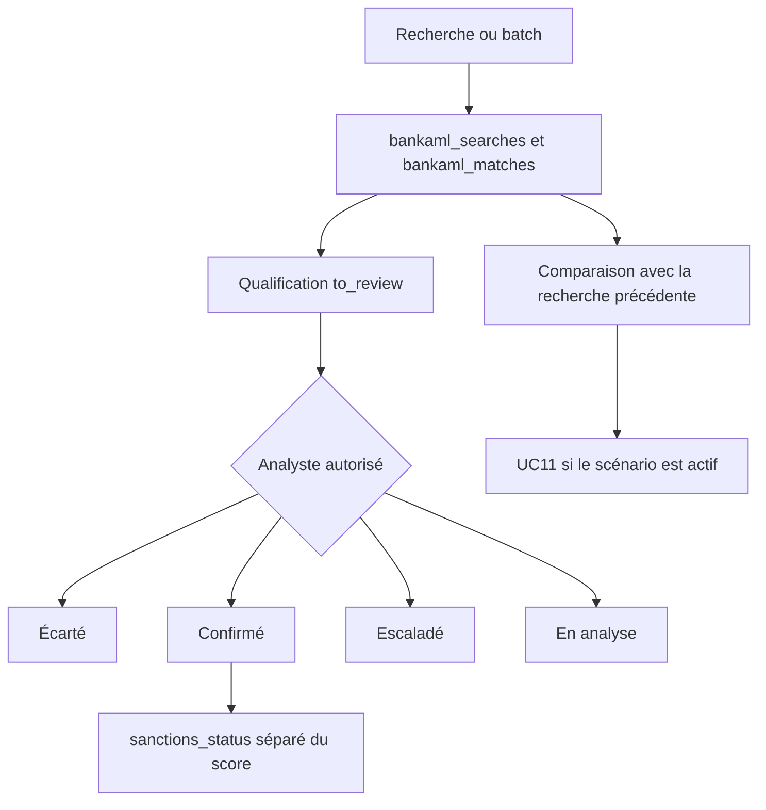

# Screening OpenSanctions

La clé d’API n’est pas dans le dépôt, le frontend ni les journaux. Le workflow `reconcile-aml` la place dans le secret Kubernetes `marble-opensanctions`, clé `api-key`. Les déploiements `marble-api` et `marble-worker` la lisent par `SCREENING_OPENSANCTIONS_API_KEY` et `OPENSANCTIONS_API_KEY`.

## Configuration déployée avec l’image latest

| Variable | Valeur |
|---|---|
| Hôte | `https://api.opensanctions.org` |
| Méthode | `apikey` |
| Scope | `default` |
| Algorithme natif | `logic-v2` |

L’hôte précédent `http://marble-motiva:8000` n’est plus celui de Marble. Le déploiement Yente / Motiva reste dans le namespace, mais Marble ne l’appelle plus. L’API hébergée ne fournit pas, dans le client du module, un flux de changement de liste en temps réel. Le batch compare deux réponses successives. Une absence n’est pas une radiation.

## Deux clients

Le client natif (`api/infra/screening.go`, `api/repositories/screening`) envoie la clé en paramètre `api_key` lorsque la méthode reste le mode SaaS. La valeur `apikey` n’est ni `bearer` ni `basic`, donc ce mode est conservé.

Le client du module (`api/bankaml/opensanctions.go`) envoie `Authorization: ApiKey`. Il appelle `POST /match/{scope}` avec `algorithm=logic-v2`, un seuil et une limite de 20. Le corps ne contient que les champs non vides : nom, alias, date de naissance, nationalité, pays, identifiant. Le score de la réponse, s’il est présent, est ramené sur 100. S’il est absent, il reste vide.

Délai minimum entre appels : 200 ms. Deux reprises sur 429 ou 5xx. Délai d’attente : 20 s. Corps limité à 2 Mo. La clé n’est pas écrite dans l’erreur renvoyée au client.

La recherche manuelle du module refuse un second appel identique pendant une minute, sauf `force`.

## Qualification humaine

Les qualifications du module sont `to_review`, `in_analysis`, `dismissed`, `confirmed`, `escalate` et `error`. Une confirmation exige un motif. L’auteur d’une qualification doit avoir un rôle autorisé. Un nom similaire reste `to_review` tant qu’un analyste ne tranche pas.

Le screening natif de la fiche client Marble reste soumis à la licence. Le bouton de la fiche ouvre la page `/aml`, qui appelle `/bank-aml` et ne dépend pas de cet entitlement.

## Champs transmis

Le module retourne à l’appelant la liste des champs envoyés et la destination. Il ne journalise pas la clé. `dataset_version` et une référence durable vers la réponse brute hors de la colonne `raw` ne sont pas implémentés. La colonne `raw` contient la charge retenue, dans la limite de taille du client.

## Licence

Le scénario natif « AML screening » peut rester non publié. Ce document ne décrit pas de contournement. Le screening utilisable sans entitlement est celui du module `bankaml`.
