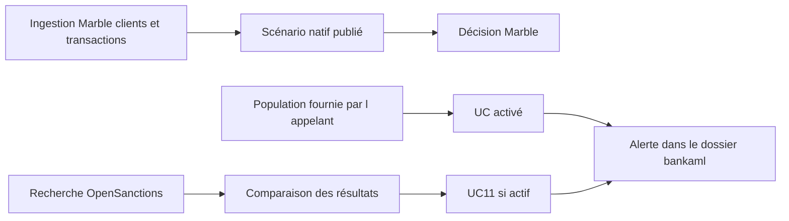

# Catalogue des scénarios AML-001 à AML-025

Les seuils cités sont les valeurs d’exemple du code ou du job d’initialisation. La conformité de la banque doit les remplacer. Ils ne sont pas des normes légales.

Deux moteurs coexistent :

- **Marble** : scénarios « AML transaction check » (publié) et « AML screening » (enregistré, publication refusée sans licence sanctions).
- **Module** : UC01 à UC12, brouillons désactivés, exécutés seulement après approbation par un autre utilisateur.

| Scénario | Moteur existant | Logique réellement codée | Absent |
|---|---|---|---|
| AML-001 Fractionnement | UC01 | opérations de montants proches, somme et nombre minimum sur une fenêtre, par compte | pas de direction, pas de devise, pas d’intention déduite |
| AML-002 Hausse de volume | UC02 | volume et nombre sur une fenêtre d’observation contre une baseline, par client | clients sans historique : le code compare à une baseline vide ; le résultat dépend des transactions fournies |
| AML-003 Fréquence | UC02 en partie | le même scénario compare aussi le nombre d’opérations | pas de scénario de fréquence séparé |
| AML-004 Montant atypique | règle Marble « Large amount » | `amount >= 10000` sur `transactions`, score 40 | pas de comparaison au profil ni à l’historique |
| AML-005 Espèces | UC05 | montant, nombre et fenêtre si `channel` vaut `cash`, avec un multiple d’historique | la table Marble `transactions` n’a pas de canal ni de `is_cash` |
| AML-006 Proche d’un seuil interne | — | — | aucun calcul de proximité |
| AML-007 Entrées puis sorties | UC03 | entrées puis sorties dans un délai, proportion et montant minimum | le rapprochement des montants inexacts est la proportion codée, pas une méthode de fonds |
| AML-008 Circulation circulaire | UC04 | parcours de transferts jusqu’à une profondeur, tolérance de montant | pas de graphe de contreparties persisté ; doublons non traités au-delà du parcours en mémoire |
| AML-009 Comptes intermédiaires | — | — | UC04 ne décrit pas une chaîne de comptes intermédiaires distincte |
| AML-010 Concentration puis redistribution | UC06 en partie | concentration et nombre de contreparties | pas de compte séparé des sources et des bénéficiaires |
| AML-011 Rotation des fonds | — | — | pas de solde |
| AML-012 Contreparties distinctes | UC06 | seuil `max_counterparties` sur une fenêtre | pas de comparaison à l’historique des contreparties |
| AML-013 Plusieurs clients vers un bénéficiaire | UC10 | nombre de clients vers une même contrepartie | la contrepartie est une chaîne, pas une entité rapprochée |
| AML-014 Réseau lié | — | — | pas de `CustomerRelationship` |
| AML-015 Nouveaux bénéficiaires | — | — | pas d’historique de bénéficiaires |
| AML-016 Juridictions | règle Marble et UC07 | Marble : pays `KP` ou `IR`, score 100. UC07 : liste `countries` | la liste n’a pas de version ni de date d’effet ; ce n’est pas une liste légale |
| AML-017 Activité internationale | — | — | pas de comparaison au profil de pays |
| AML-018 Nouveaux pays | — | — | un seul champ `country` |
| AML-019 Reprise après inactivité | UC08 | première activité après `inactive_days` au-dessus d’un montant | l’inactivité est calculée sur les transactions fournies, pas sur un statut de compte |
| AML-020 Incohérence KYC | UC09 | volume ou nombre au-dessus du profil attendu | pas de contrôle des canaux, des pays ni de la fraîcheur comme dimensions séparées |
| AML-021 Compte récent | — | — | pas de date d’ouverture de compte |
| AML-022 Changement de canal | — | — | `channel` existe sur la transaction du module, sans scénario |
| AML-023 Nouveau screening | UC11 | `ScreeningAlerts` ouvre une revue sur un résultat nouveau, modifié ou disparu | la disparition n’est pas une radiation ; les erreurs de provider ne sont pas un résultat négatif |
| AML-024 KYC incomplet | — | — | pas de statut ni de date de revue |
| AML-025 Changement de profil | — | — | le profil n’est pas versionné |

## Parcours jusqu’à une alerte

Le scénario natif « AML transaction check » peut produire une décision sans passer par `bankaml`. Les UC ne produisent un dossier que si le scénario est actif et que l’appel demande l’ouverture avec le droit correspondant. UC11 suit cette même règle d’activation.

## Ce qui n’est pas opérationnel

UC01 à UC12 sont désactivés tant qu’ils ne sont pas approuvés. Les présenter comme la surveillance en production serait inexact. Le scénario natif publié est limité aux deux règles d’initialisation : montant et pays.
