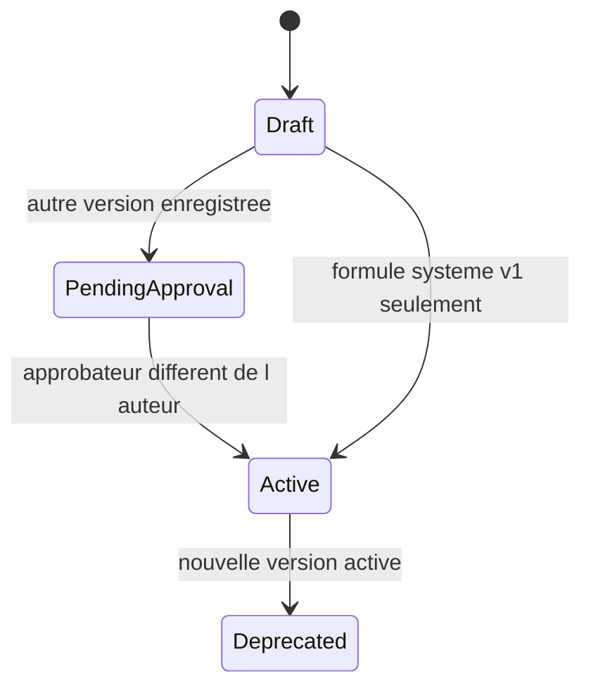

# Modèle de scénario AML

Le JSON cible de la partie B n’est pas le schéma d’un scénario Marble. Marble stocke une itération dont le corps contient un AST de règles, des seuils de score et, pour le screening, une configuration de screening. Le module `bankaml` stocke un code, une description, un objet `params`, une sévérité et un drapeau `enabled`.

## Marble natif

Un scénario a un `trigger_object_type`. Une itération contient :

- `trigger_condition_ast_expression`
- `score_review_threshold`, `score_block_and_review_threshold`, `score_decline_threshold`
- `rules[]` avec `formula_ast_expression`, `score_modifier`, `rule_group`
- éventuellement une configuration de screening

Les opérateurs vus dans la configuration déployée sont `>=`, `=`, `Or` et `IsNotEmpty`. L’AST Marble couvre d’autres fonctions natives. Elles n’ont pas été revalidées une à une pour cette note. Aucun champ n’accepte du SQL ou du code fourni par l’administrateur : la formule est un arbre nommé.

Publication : valider l’itération, la committer, puis `POST /scenario-publications` avec `publication_action: publish`. La publication d’un scénario de screening est refusée sans l’entitlement sanctions. Le contrôle de licence n’est pas retiré.

États réels du scénario natif : brouillon d’itération, itération commitée, version live. Les états cibles `IN_REVIEW` et `DEPRECATED` ne sont pas des statuts de ce flux.

## Module complémentaire

```json
{
  "code": "UC01",
  "version": 1,
  "status": "draft",
  "enabled": false,
  "severity": "high",
  "priority": "high",
  "params": {}
}
```

`status` prend les valeurs écrites par le module (`draft`, puis `pending_approval` pour une nouvelle version, `active` après approbation). `EvaluateScenarios` n’exécute une règle que si `enabled` est vrai et `status` vaut `active`. L’approbateur doit être différent de l’auteur.

UC11 n’est pas dans le `switch` de `EvaluateScenarios`. Il est évalué par `ScreeningAlerts` après une comparaison de résultats. UC12 n’est pas une règle de déclenchement : le score est recalculé par `CalculateScore` quand l’API de score est appelée.

L’évaluation reçoit une `Population` déjà chargée. Elle ne parcourt pas les tables Marble.

## Cycle de vie



La formule de score v1 est créée active, avec l’auteur `system`, parce qu’elle est le point de départ documenté comme non réglementaire. Les scénarios UC ne suivent pas ce raccourci : ils restent désactivés tant qu’un autre utilisateur ne les approuve pas.

Une alerte et un dossier conservent `scenario_code`. Ils ne conservent pas un identifiant immutable de version autre que le code et la version lus au moment de l’évaluation. La version exécutée n’est pas une colonne dédiée de `bankaml_cases`.

## Simulation

`POST /bank-aml/scenario-evaluations` évalue les scénarios activés. Le paramètre `commit=true` n’ouvre un dossier que si l’appelant a aussi le droit de validation. Sans ce mode, l’évaluation ne crée pas le dossier. Il n’y a pas de rapport persisté de période testée, de volume lu, de faux positifs ou de couverture.

## Agrégations et devises

Les fonctions cibles `COUNT`, `SUM`, `AVG`, `MIN`, `MAX`, `DISTINCT_COUNT` ne sont pas un langage configuré. Chaque UC code son calcul en Go. Les sommes ignorent la devise. Les annulations et contrepassations ne sont pas filtrées, parce que le modèle de transaction du module n’a pas de statut ni de `reversal_of_transaction_id`.
